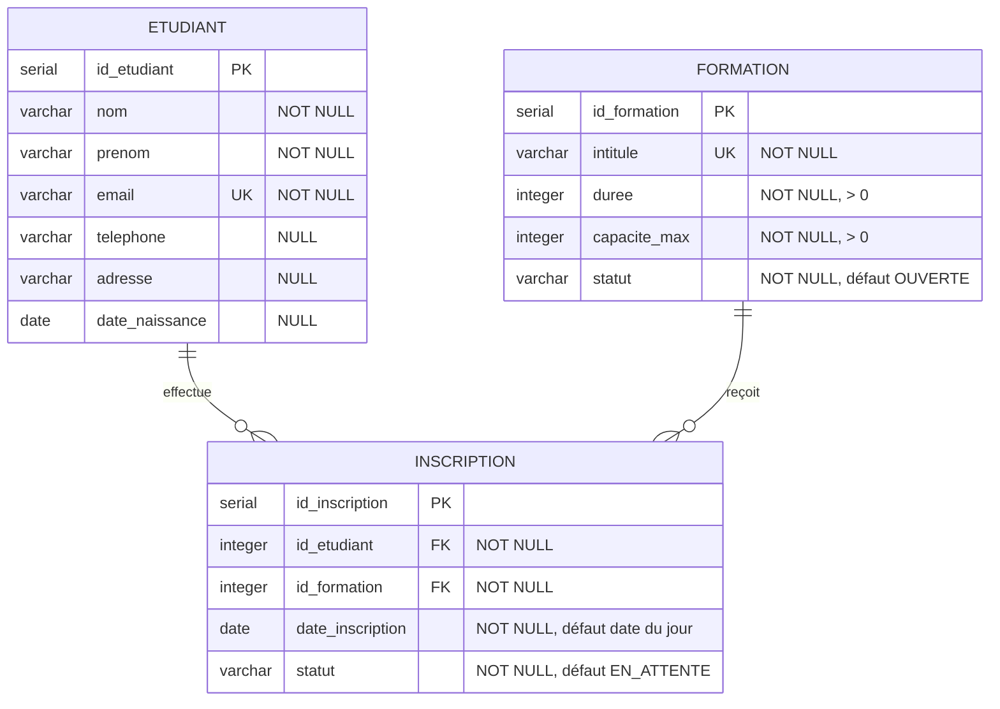

# Modèle de données PostgreSQL

Ce document décrit le modèle de données de l'application. Il correspond à la
migration Flyway `src/main/resources/db/migration/V1__init.sql`.

## Diagramme entité-relation

## Relations

| Relation | Cardinalité | Implémentation |
|---|---|---|
| Etudiant - Inscription | 1 étudiant a 0..n inscriptions | `inscription.id_etudiant` référence `etudiant.id_etudiant` |
| Formation - Inscription | 1 formation a 0..n inscriptions | `inscription.id_formation` référence `formation.id_formation` |
| Etudiant - Formation | plusieurs-à-plusieurs | via la table d'association `inscription` |

La suppression d'un étudiant ou d'une formation supprime ses inscriptions
(`ON DELETE CASCADE`).

## Spécification des tables

### etudiant

| Colonne | Type | Clé | Null ? | Contrainte |
|---|---|---|---|---|
| id_etudiant | SERIAL | PK | non | généré automatiquement |
| nom | VARCHAR(100) | | non | |
| prenom | VARCHAR(100) | | non | |
| email | VARCHAR(255) | UNIQUE | non | `uq_etudiant_email` |
| telephone | VARCHAR(30) | | oui | |
| adresse | VARCHAR(255) | | oui | |
| date_naissance | DATE | | oui | |

### formation

| Colonne | Type | Clé | Null ? | Contrainte |
|---|---|---|---|---|
| id_formation | SERIAL | PK | non | généré automatiquement |
| intitule | VARCHAR(150) | UNIQUE | non | `uq_formation_intitule` |
| duree | INTEGER | | non | `duree > 0` |
| capacite_max | INTEGER | | non | `capacite_max > 0` |
| statut | VARCHAR(20) | | non | `OUVERTE`, `FERMEE` ou `ARCHIVEE` ; défaut `OUVERTE` |

### inscription

| Colonne | Type | Clé | Null ? | Contrainte |
|---|---|---|---|---|
| id_inscription | SERIAL | PK | non | généré automatiquement |
| id_etudiant | INTEGER | FK | non | référence `etudiant`, `ON DELETE CASCADE` |
| id_formation | INTEGER | FK | non | référence `formation`, `ON DELETE CASCADE` |
| date_inscription | DATE | | non | défaut : date du jour |
| statut | VARCHAR(20) | | non | `EN_ATTENTE`, `VALIDEE` ou `ANNULEE` ; défaut `EN_ATTENTE` |
| (id_etudiant, id_formation) | | UNIQUE | | `uq_inscription_etudiant_formation` : un étudiant ne s'inscrit qu'une fois à une formation |

## Règles métier portées par la base

- Un email identifie un seul étudiant.
- Un intitulé identifie une seule formation.
- Durée et capacité sont strictement positives.
- Les statuts sont limités à une liste de valeurs autorisées.
- Un étudiant ne peut pas être inscrit deux fois à la même formation.

La règle « ne pas dépasser `capacite_max` » est vérifiée dans la couche service
de l'application (réponse HTTP 409), pas dans la base.